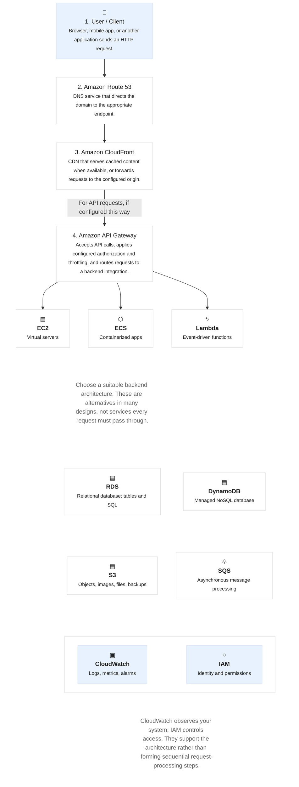

# AWS-Basics
Hands-on AWS learning repository covering cloud computing fundamentals, core AWS services, networking, IAM, storage, and practical labs with documentation.

# AWS Architecture

## AWS Request Flow

## Component Summary

| AWS Component | Purpose |
|---|---|
| User / Client | Sends HTTP requests |
| Route 53 | DNS resolution |
| CloudFront | Content delivery and caching |
| API Gateway | API routing and access controls |
| EC2 | Virtual servers |
| ECS | Container orchestration |
| Lambda | Serverless functions |
| RDS | Relational database |
| DynamoDB | NoSQL database |
| S3 | Object storage |
| SQS | Asynchronous messaging |
| CloudWatch | Monitoring and logs |
| IAM | Identity and access permissions |
